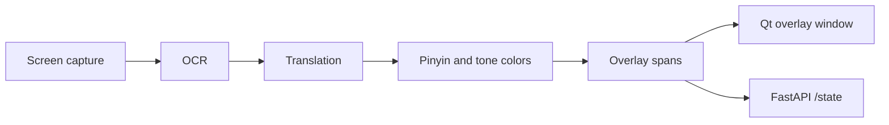

# Immersion Assistant

A macOS desktop prototype for practicing Mandarin while you work. It takes screenshots of your screen, reads the visible text with OCR, runs each piece of text through a translation step, adds pinyin, and draws the result in a see-through overlay on top of the original text.

This is an early prototype. The pipeline runs end to end, but no translation model is plugged in yet: the translation step uses your glossary for known words and otherwise passes the text through unchanged (see step 3 below).

## How it works

The app runs a simple polling loop. Every few seconds (3 in the desktop app, 4 in the API server) it does one "tick" of the pipeline and stores the result in memory. A UI (the Qt overlay or the HTTP API) reads that stored result.



1. **Screen capture** (`src/immersion/pipeline/screen_capture.py`). `ScreenCapture` uses Apple's Quartz API (through `pyobjc`) to grab an image of everything on screen, then converts the raw BGRA pixel buffer into a Pillow image. If Quartz isn't available (for example on a non-Mac machine), it returns a blank black frame so the rest of the pipeline can still run.

2. **OCR** (`src/immersion/pipeline/ocr.py`). `OCRProcessor` sends the screenshot to Tesseract through `pytesseract.image_to_data`, using English and Simplified Chinese (`eng+chi_sim`) by default. Tesseract returns each word with a bounding box and a confidence score, so every later step works one word at a time. Empty results and anything under the confidence threshold (0.65 by default) are dropped, so the overlay isn't filled with noise.

3. **Translation** (`src/immersion/pipeline/translation.py`). `TranslationPipeline` first checks the user's glossary for an exact match. If there is one, it uses that and marks the span as a glossary hit. If not, it calls a translation provider through an LRU cache, because most of the screen stays the same between ticks and the same strings would otherwise be translated again and again. Providers share a small `TranslationProvider` interface. The only provider in the code right now is `EchoTranslator`, a placeholder that returns the input text unchanged. The config has a `provider` setting (default `local_marian`), but nothing reads it yet, so the app always uses `EchoTranslator`. A real model would be added as another `TranslationProvider`.

4. **Pinyin and tone colors** (`src/immersion/language.py`). For each translated string, `pypinyin` generates numbered pinyin (like `ni3 hao3`). The tone number at the end of each syllable is then mapped to a color, one color per tone. Characters that aren't Chinese are skipped, so English text passed through by the placeholder translator gets no pinyin. The colors are included in the API output, but the desktop overlay doesn't draw them yet.

5. **Building overlay spans** (`src/immersion/ui/overlay_model.py`). `build_overlay` pairs each OCR span with its translation and pinyin and produces an `OverlaySpan`: the box position, the original text, the translated text, pinyin, tone colors, and the glossary flag. This is the single data shape both UIs read.

6. **Orchestration** (`src/immersion/app.py`). `ImmersionApp` loads the config, builds the capture, OCR and translation objects, and runs the loop. Each tick calls capture, OCR, translation and `build_overlay` in order, then swaps in a new `ImmersionState`. Errors in a tick are logged and the loop keeps going. Logs are written to `~/.immersion/app.log` and to the console.

7. **Display**. There are two ways to see the output:
   - **Desktop overlay** (`src/immersion/ui/desktop.py`, `src/immersion/ui/overlay_window.py`). The pipeline runs in a background thread while a full-screen PySide6 window sits on top of everything. The window is frameless, transparent, and ignores mouse clicks, so you can keep using the apps underneath. Every 500 ms it reads the latest spans and paints a dark rounded box at each text location with the translation and pinyin inside.
   - **HTTP API** (`src/immersion/server.py`). A FastAPI app starts the pipeline in a background thread and exposes `GET /state`, which returns the current spans as JSON. This is meant for other front ends, like a browser extension, that want the same data.

### Configuration

Settings are plain dataclasses in `src/immersion/config.py`. On startup the app looks for `~/.immersion_assistant.yml`. If the file doesn't exist, the defaults are used. The file can set OCR languages and confidence threshold, translation settings (target language, cache size), and a glossary of fixed translations. The file also accepts overlay and excluded-app settings, but the code doesn't use them yet.

## Project layout

```
src/immersion/
  app.py              main loop that runs the pipeline and holds the latest state
  config.py           YAML config loading and default settings
  language.py         pinyin and tone color helpers
  logging_utils.py    file + console logging setup
  server.py           FastAPI app exposing GET /state
  pipeline/
    screen_capture.py Quartz screenshot capture
    ocr.py            Tesseract OCR into text spans with bounding boxes
    translation.py    glossary lookup, caching, translation provider interface
  ui/
    overlay_model.py  OverlaySpan data model and build_overlay
    overlay_window.py transparent PySide6 overlay window
    desktop.py        runs the pipeline thread and the Qt overlay together
docs/
  ARCHITECTURE.md     notes on data flow and planned extension points
```

## Tech stack

- Python 3.10+
- Quartz via `pyobjc-framework-Quartz` (macOS screen capture)
- Tesseract OCR via `pytesseract`, Pillow for images
- `pypinyin` for pinyin
- PySide6 (Qt) for the overlay window
- FastAPI, Pydantic and Uvicorn for the HTTP API
- PyYAML for config

## Running it

You need macOS (screen capture uses Quartz), Python 3.10 or newer, and Tesseract with the Simplified Chinese language data:

```bash
brew install tesseract tesseract-lang
```

Install the package in a virtual environment:

```bash
python3 -m venv .venv
source .venv/bin/activate
pip install -e ".[dev]"
```

macOS will ask for Screen Recording permission for your terminal (or Python) the first time the app captures the screen. Without it, the screenshots won't include other apps' windows.

Optionally create `~/.immersion_assistant.yml`:

```yaml
ocr:
  languages: ["eng", "chi_sim"]
  confidence_threshold: 0.70
translation:
  target_language: zh-CN
glossary:
  OK: 好的
```

Run the desktop overlay:

```bash
python -m immersion.ui.desktop
```

Or run the HTTP API and read the state from another tool:

```bash
python -m immersion.server
curl http://127.0.0.1:8777/state
```

No API keys or environment variables are needed. Everything runs locally.
